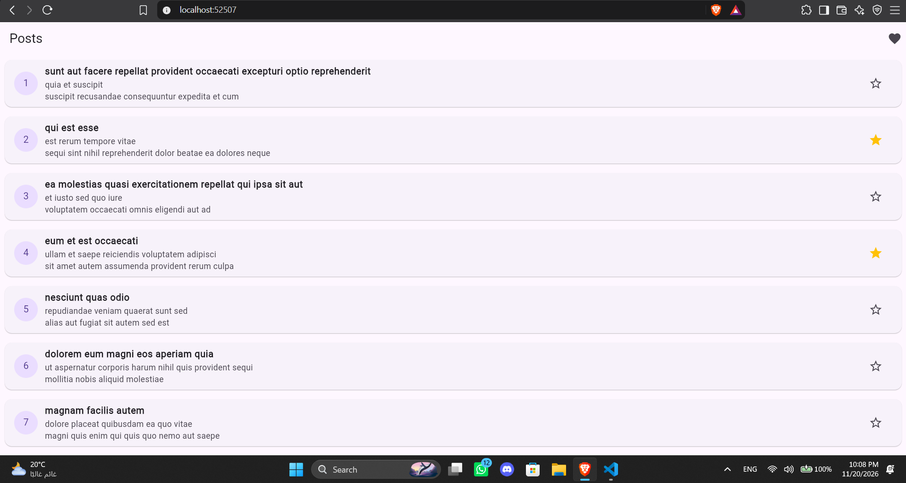
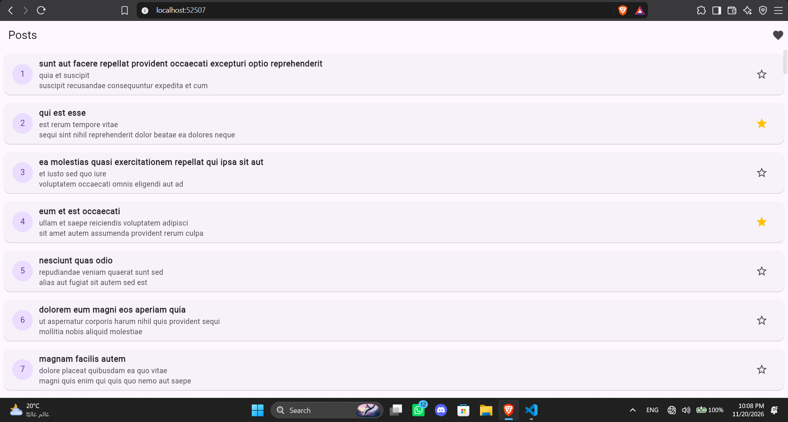
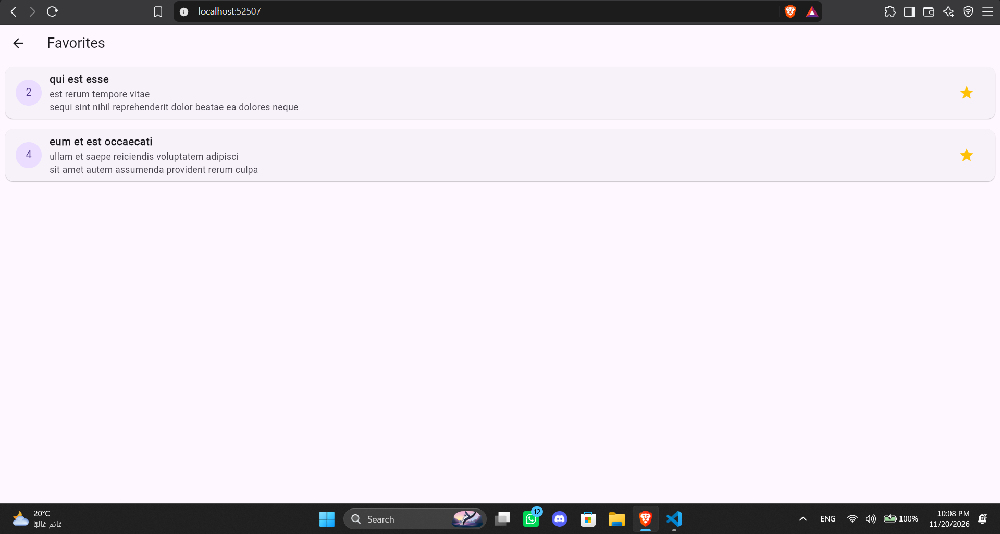

# Offline Posts App (Flutter + Hive)

A Flutter app that fetches posts from JSONPlaceholder, caches them locally
with Hive so they work without internet, and lets users save favorites.

## Features
- Fetches posts from the API and caches them in Hive (`postsBox`)
- Offline mode: shows the last saved posts when there is no connection
- Pull-to-refresh
- Mark/unmark posts as favorites (filled / outlined star)
- Favorites screen with "No favorites yet" empty state
- Favorites stored in a separate box (`favoritesBox`), so they survive refresh and restart

## Tech Stack
Flutter, Dart, Hive, hive_flutter, http

## Project Structure
```
lib/
├── main.dart
├── models/post_model.dart (+ generated post_model.g.dart)
├── services/post_service.dart, favorites_service.dart
├── screens/posts_screen.dart, favorites_screen.dart
└── widgets/post_card.dart
```


## How It Works
- `PostService`: tries the API first, saves to Hive, falls back to Hive on failure
- `FavoritesService`: toggleFavorite, isFavorite, getFavorites
- Favorites use a copy of the Post, because a HiveObject can only live in one box
- Favorites live in their own box because `postsBox.clear()` runs on every refresh


## Screenshots
### 1. Posts loaded online

### 2. Posts loaded offline (airplane mode)

### 3. Favoriting a post

### 4. Favorites screen



## Run
```
flutter pub get
dart run build_runner build --delete-conflicting-outputs
flutter run
```

## Author
AbdelRahman Elbahgy, Alexandria University
